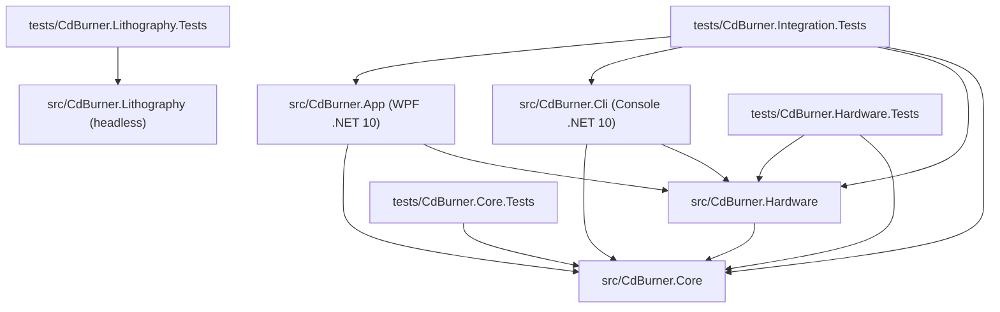
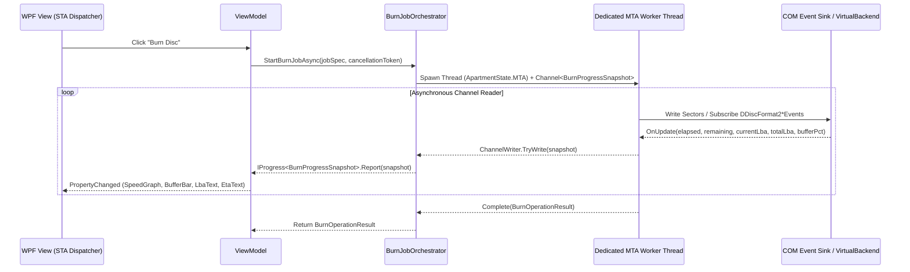

# CdBurner: System Architecture & Interop Blueprint

## 1. Architectural Principles
1. **Strict Layered Separation**:
   - `CdBurner.Core`: Zero dependencies on WPF or concrete Win32/COM classes. Contains all domain models, optical math (`LbaAddress`, `MsfAddress`), compilation trees, pure-C# ISO/El Torito/CUE/CD-Text/DVD-Video builders & parsers, and service interfaces.
   - `CdBurner.Hardware`: Implements `CdBurner.Core` hardware interfaces using Windows IMAPIv2 COM interop (`imapi2.dll`, `imapi2fs.dll`), Win32 `DeviceIoControl` (`IOCTL_SCSI_PASS_THROUGH_DIRECT`, `IOCTL_CDROM_RAW_READ`, `IOCTL_CDROM_READ_TOC_EX`), Windows Media Foundation (`IMFSourceReader`), and the `VirtualDiscBackend` simulator.
   - `CdBurner.Cli`: Command-line front-end exposing all operations with `--json` output and `--virtual` drive flags.
   - `CdBurner.App`: Windows 10/11 WPF Fluent UI application following strict MVVM (`CommunityToolkit.Mvvm`).
2. **100% Hardware-Free Testability**:
   - Every service in `CdBurner.Core` and `CdBurner.Hardware` can be exercised end-to-end against `VirtualDiscBackend` so automated `dotnet test` runs in CI never block waiting for a physical optical drive.

---

## 2. Solution & Project Dependency Graph



---

## 3. Core Abstractions (`src/CdBurner.Core/Abstractions/`)

```csharp
namespace CdBurner.Core.Abstractions;

public interface IDiscDeviceService
{
    IReadOnlyList<IDiscRecorderBackend> GetRecorders(bool includeVirtual = true);
    IDiscRecorderBackend? GetRecorderById(string uniqueId);
    event EventHandler<DeviceChangeEventArgs>? DeviceChanged;
}

public interface IDiscRecorderBackend : IDisposable
{
    string UniqueId { get; }
    string VendorId { get; }
    string ProductId { get; }
    string ProductRevision { get; }
    string VolumePath { get; } // e.g. "E:\" or "V:\Virtual0"
    bool IsVirtual { get; }

    DriveCapabilitiesDto GetCapabilities();
    MediaStatusDto QueryMediaStatus();
    void EjectMedia();
    void CloseTray();
    bool AcquireExclusiveAccess(string clientName);
    void ReleaseExclusiveAccess();
}

public interface IBurnEngineBackend
{
    Task<BurnOperationResult> BurnDataStreamAsync(
        IDiscRecorderBackend recorder,
        Stream imageStream,
        DataBurnOptions options,
        IProgress<BurnProgressSnapshot>? progress,
        CancellationToken cancellationToken);

    Task<BurnOperationResult> BurnAudioTracksAsync(
        IDiscRecorderBackend recorder,
        IReadOnlyList<AudioTrackSource> tracks,
        AudioBurnOptions options,
        IProgress<BurnProgressSnapshot>? progress,
        CancellationToken cancellationToken);

    Task<BurnOperationResult> EraseMediaAsync(
        IDiscRecorderBackend recorder,
        bool fullErase,
        IProgress<BurnProgressSnapshot>? progress,
        CancellationToken cancellationToken);

    Task<RipOperationResult> ReadSectorsAsync(
        IDiscRecorderBackend recorder,
        int startLba,
        int sectorCount,
        bool raw2352Mode,
        Func<int, ReadOnlyMemory<byte>, ValueTask> sectorConsumer,
        IProgress<BurnProgressSnapshot>? progress,
        CancellationToken cancellationToken);
}
```

---

## 4. Pinned Windows IMAPIv2 COM GUIDs (`src/CdBurner.Hardware/Interop/Imapi2Guids.cs`)

Use these exact GUID constants when declaring COM CoClasses and Interfaces:

```csharp
namespace CdBurner.Hardware.Interop;

public static class Imapi2Guids
{
    // CoClasses (CLSIDs)
    public const string CLSID_MsftDiscMaster2          = "2735412E-7F64-5B0F-8F00-5D77AFBE261E";
    public const string CLSID_MsftDiscRecorder2        = "2735412D-7F64-5B0F-8F00-5D77AFBE261E";
    public const string CLSID_MsftDiscFormat2Data      = "2735412A-7F64-5B0F-8F00-5D77AFBE261E";
    public const string CLSID_MsftDiscFormat2TAO       = "27354129-7F64-5B0F-8F00-5D77AFBE261E";
    public const string CLSID_MsftDiscFormat2RawCD     = "27354128-7F64-5B0F-8F00-5D77AFBE261E";
    public const string CLSID_MsftDiscFormat2Erase     = "2735412B-7F64-5B0F-8F00-5D77AFBE261E";
    public const string CLSID_MsftFileSystemImage      = "2C941FC5-975B-59BE-A960-9A2A262853A5";
    public const string CLSID_MsftBootOptions          = "2C941FCE-975B-59BE-A960-9A2A262853A5";
    public const string CLSID_MsftIsoImageManager      = "CEEE3B62-8F56-4056-869B-EF16917E3EFC";

    // Interfaces (IIDs)
    public const string IID_IDiscMaster2               = "27354130-7F64-5B0F-8F00-5D77AFBE261E";
    public const string IID_IDiscRecorder2             = "27354133-7F64-5B0F-8F00-5D77AFBE261E";
    public const string IID_IDiscRecorder2Ex           = "27354132-7F64-5B0F-8F00-5D77AFBE261E";
    public const string IID_IDiscFormat2Data           = "27354153-9F64-5B0F-8F00-5D77AFBE261E";
    public const string IID_IDiscFormat2TAO            = "27354154-8F64-5B0F-8F00-5D77AFBE261E";
    public const string IID_IDiscFormat2RawCD          = "27354155-8F64-5B0F-8F00-5D77AFBE261E";
    public const string IID_IDiscFormat2Erase          = "27354156-8F64-5B0F-8F00-5D77AFBE261E";
    public const string IID_IFileSystemImage           = "2C941FE1-975B-59BE-A960-9A2A262853A5";
    public const string IID_IFileSystemImage2          = "D7644B2C-1537-4767-B62F-F1387B02DDFD";
    public const string IID_IFileSystemImage3          = "7CFF842C-7E97-4807-8304-910DD8F7C051";
    public const string IID_IBootOptions               = "2C941FD4-975B-59BE-A960-9A2A262853A5";

    // Event Sinks (Connection Point IIDs, DISPID 0x200 = Update)
    public const string IID_DDiscMaster2Events         = "27354131-7F64-5B0F-8F00-5D77AFBE261E";
    public const string IID_DDiscFormat2DataEvents     = "2735413C-7F64-5B0F-8F00-5D77AFBE261E";
    public const string IID_DDiscFormat2TAOEvents      = "2735413D-7F64-5B0F-8F00-5D77AFBE261E";
    public const string IID_DDiscFormat2RawCDEvents    = "27354142-7F64-5B0F-8F00-5D77AFBE261E";
    public const string IID_DDiscFormat2EraseEvents    = "2735413A-7F64-5B0F-8F00-5D77AFBE261E";
}
```

---

## 5. Win32 SCSI Pass-Through Direct & MMC-5 Structures (`src/CdBurner.Hardware/Scsi/`)

To execute low-level MMC-5 commands (CD-Text read/write, raw CD-DA extraction, ATIP/ADIP media manufacturer ID lookup, C2 error scan, and DVD+R Book Type bitsetting), use `DeviceIoControl` on `\\.\CdRom0` or `\\.\E:` with `IOCTL_SCSI_PASS_THROUGH_DIRECT = 0x0004D014`:

```csharp
[StructLayout(LayoutKind.Sequential)]
public unsafe struct ScsiPassThroughDirect
{
    public ushort Length;              // sizeof(ScsiPassThroughDirect)
    public byte ScsiStatus;
    public byte PathId;
    public byte TargetId;
    public byte Lun;
    public byte CdbLength;             // 6, 10, 12, or 16
    public byte SenseInfoLength;       // e.g. 32
    public byte DataIn;                // SCSI_IOCTL_DATA_OUT = 0, SCSI_IOCTL_DATA_IN = 1, SCSI_IOCTL_DATA_UNSPECIFIED = 2
    public uint DataTransferLength;
    public uint TimeOutValue;          // Seconds
    public nint DataBuffer;            // Pointer to pinned buffer
    public uint SenseInfoOffset;       // Offset to SenseBuffer in wrapper struct
    public fixed byte Cdb[16];
}
```

### Standard MMC-5 OpCodes Supported by `MmcCommandBuilder`:
- `0x12` — `INQUIRY` (Vendor, Product, Firmware Revision)
- `0x46` — `GET CONFIGURATION` (Active Profile & Feature Descriptors)
- `0x51` — `READ DISC INFORMATION` (Disc Status, Erasable, Number of Sessions, Lead-In/Lead-Out)
- `0x43` — `READ TOC/PMA/ATIP` (Format `0x00` TOC, `0x02` Full TOC, `0x04` ATIP, `0x05` CD-Text)
- `0xAD` — `READ DISC STRUCTURE` (DVD Physical Format Information, Manufacturer ID, Copyright, Book Type)
- `0xBF` — `SEND DISC STRUCTURE` (DVD+R/+RW/+R DL Book Type Bitsetting)
- `0xBE` — `READ CD` (Raw 2352-byte sector + C2 error pointers + P-W subchannel extraction)
- `0x5D` — `SEND CUE SHEET` (DAO layout & Lead-In CD-Text reservation)
- `0x35` — `SYNCHRONIZE CACHE (10)`

---

## 6. Threading & Async Progress Pipeline



---

## 7. WPF Application Architecture (`src/CdBurner.App/`)

- **Dependency Injection**: `Microsoft.Extensions.DependencyInjection` configured in `App.xaml.cs`.
- **Navigation Shell (`MainWindow.xaml` & `MainViewModel.cs`)**:
  - **Left Navigation Rail**:
    1. `Data Disc` (`DataBurnViewModel`)
    2. `Audio CD` (`AudioBurnViewModel`)
    3. `DVD-Video` (`DvdVideoViewModel`)
    4. `Disc Image (ISO/CUE)` (`ImageStudioViewModel`)
    5. `Drive Utilities & Scan` (`DriveUtilitiesViewModel`)
    6. `Virtual Drive Manager` (`VirtualDriveViewModel`)
    7. `Settings & Logs` (`SettingsViewModel`)
  - **Top Hardware Ribbon**: Recorder ComboBox, Refresh button, Eject/Close Tray buttons, Virtual Media quick-mount dropdown, Write Speed selector, and Burn Mode pills.
  - **Bottom Capacity & Status Bar**: Animated segmented capacity progress bar (`Green` $\rightarrow$ `Amber` $\rightarrow$ `Red Overburn`), exact byte/LBA counter, and active background task indicator.

---

## 8. Lithography Module (`src/CdBurner.Lithography/`)

`CdBurner.Lithography` is a headless library (no WPF, no COM, no reference to Core or Hardware) for turning images
into disc-surface patterns. It holds the pure geometry in `Geometry/` (namespace `CdBurner.Lithography.Geometry`):
LBA and track length to radius and angle, polar page layout and a streaming rasterizer. Its tests live in
`tests/CdBurner.Lithography.Tests`. It was split out of Core so that code ported from an upstream project stays in
one assembly with a clear provenance boundary. Nothing in it touches a drive.

- `Geometry/DiscPresetGeometry.cs`: clean-room conversion of schema-4 disc presets (including normalized cubic pitch coefficients `p(x) = p0 * (1 + c1*x + c2*x^2 + c3*x^3)`) into IgnisDisc's unified `SpiralGeometry` + `ConstantTrackPitch` / `CubicTrackPitch` by solving the exact arc-length integral.
- `Ported/DiscImageStudio/Core/ToneProfile.cs` (namespace `CdBurner.Lithography`): shared `ToneProfile` and `ToneDither` (sRGB linearization, brightness offset, and hashed per-sample dither) used across CD, DVD, and Blu-ray encoders.
- `Ported/DiscImageStudio/Presets/` (namespace `CdBurner.Lithography.Presets`): `DiscPresetJsonStore` and embedded `built-in-disc-presets.json` (schema 4 catalog with schema 2/3 load compatibility and `%APPDATA%\IgnisDisc\disc-presets.json` user overrides).
- `Ported/DiscImageStudio/Cd/` (namespace `CdBurner.Lithography.Cd`, ported from DiscImageStudio, see
  `THIRD-PARTY-NOTICES.md`): `CdTrackGenerator` turns a picture into a CD-DA picture track (`.wav` + one-track
  `.cue`, or big-endian `.raw`) through the `0x0D`/`0xAA` palette (`CdToneMapping`, `ToneProfile` dither) and the
  CIRC delay interleaver (`CddaInterleaver`, from CDImage); `RenderTrack`/`PreviewTrack` read a track back into the
  picture (from a file or from sectors read off a disc). `CdMode1Drawing` makes 2,048-byte Mode 1 sectors whose bytes
  after the drive's ECMA-130 scrambler are palette bytes, and reads them back. `CdDiscParameters` carries upstream's
  three cubic pitch coefficients (zero coefficients keep the constant-pitch formula and its bytes), and
  `GeneratePattern` writes a calibration target as a track.
- `Ported/DiscImageStudio/Dvd/` (namespaces `CdBurner.Lithography.Dvd`, `.Dvd.Encoding`, `.Dvd.Solver`; ported from
  DiscImageStudio's `DvdImageSolver` and `DiscImageStudio.Dvd`): the DVD picture solver. A picture pixel becomes a
  scrambled byte `0xA5` (dark: many short pits) or `0x92` (light: few long pits); the sector stores that byte XOR the
  sector's scrambler byte. `Encoding/` holds the ECMA-267 data frame, EDC, PI/PO Reed-Solomon, the EFMPlus table
  with its sync codes (including the SY6 state 3/4 words) and NRZI; `Solver/` holds the dispersion writer
  (`FastDispersionImageWriter`, `FastDvdImageFileWriter`: a raw 2,048-byte-sector image plus a `.json` sidecar), the
  exact per-block solvers (`MultiBlockImageSolver`, `StateControlSolver`, `LocalSearchSolver`) and
  `IsoReadbackRenderer`, which turns an image file back into the picture. `dispersion-byte-pools.json` (embedded) is
  upstream's record of clustered and dispersed bytes. Upstream's `DvdTrackGeometry` is ported with it
  (`Core/DvdTrackGeometry.cs`) so the output matches upstream byte for byte; moving the solver onto `SpiralGeometry`
  is a later, separate change.
  - `Solver/DvdReadCompatibilityGuard.cs` is **not** ported: the `periodic-9b-16-v1` rule (at sector offsets 0, 16,
    ..., 2032 a picture-owned byte whose scrambled value is not `A5` or `9B` becomes `9B`) is written for IgnisDisc
    from that description. The older `bridge-9b-v1` rule is left out.
  - Left out of the DVD port: upstream's command line (`Program.cs`, `CliArguments`), its module catalog, and
    writing a picture into an image that already holds files
    (upstream's own file system writer). General image-to-DVD picture commands are not wired yet, while
    `rosetta ladder --media dvd` writes the DVD-R optical resolution-ladder `.iso` and JSON manifest burned via `burn-iso --native`.
- `Ported/DiscImageStudio/BluRay/` (namespaces `CdBurner.Lithography.BluRay` and `.BluRay.Encoding`; ported from
  `DiscImageStudio.BluRay`): the BD-R single-layer 25 GB picture generator. A picture pixel becomes a scrambled byte
  `0xAA` (dark: many 3T runs) or `0x44` (light: many 6T runs) (`BluRayRunLengthMapping`); the sector stores that byte
  XOR the cluster's scrambler byte (ISO/IEC 30190 clause 13.4, one seed for all 32 sectors of a cluster).
  `BluRayImagePayloadMapping` places every payload byte on the spiral through the LDC interleave order
  (`BluRayTrackGeometry`, constant or cubic pitch); `BluRayStreamingGenerator` writes whole 32-sector clusters only
  (start and length must be multiples of 32); `BluRayImageGenerator` writes the raw 2,048-byte-sector image and its
  `.json` sidecar (`BluRayIsoMetadata`, format `bd-r-image-v1`). `Encoding/` holds the diagnostic chain a drive
  applies: EDC, scrambler, LDC/BIS Reed-Solomon and interleave (`BluRayEccEncoder`, 76,880 bytes per cluster), 17PP
  modulation, frame sync, dc-control selection and a whole recording unit (`BluRayRecordingUnitEncoder`).
  - Left out of the Blu-ray port: upstream's command module (`BluRayDiscModule`), its file system writer (a picture
    image that also holds files is refused), previews and the burning code. Image output only: apart from
    calibration targets no command or screen uses it yet, and no disc has been written from it.
- `Ported/DiscImageStudio/Calibration/` (namespace `CdBurner.Lithography.Calibration`; ported from
  `DiscImageStudio.Core/Calibration`, no desktop code): the calibration engine. `CalibrationTarget` describes a
  target (artwork, schema version, the frozen generation parameters) and samples its pattern; the three stages
  are wide bands with angle marks (`AngleSweepBands`, coarse), a wavy light/dark boundary (`WavyBoundary`) and
  the reference cross (`ReferenceCross`, fine; its pixels are the embedded `Patterns/target_slim.gray.gz`).
  `CalibrationRingFitter` (band edges: both radii), `CalibrationBoundaryFitter` (boundary points: both radii,
  pitch kept) and `CalibrationCrossFitter` (points along one arm: both radii and the three cubic pitch
  coefficients) each return a `CalibrationFitResult` with ranked candidates and warnings.
  `CalibrationPhotoRectifier` fits the perspective of a photo from points on the outer rim and the centre hole.
  `CalibrationSessionJson` reads and writes upstream's `.calibration.json` record (target, fit options and, in
  its `photo` section, measurement points in millimetres from the disc centre). Messages are upstream's own
  English translations. The CD, DVD and Blu-ray generators take a `CalibrationTarget`; the three target goldens
  (`cd-calibration.raw`, `dvd-calibration.iso`, `bd-calibration.iso`) are matched byte for byte.
- `Calibration/` (IgnisDisc's own files, same namespace): `CalibrationTargetFile` creates a target for a stage and
  writes the burnable file with its record (`.wav` + `.cue` or `.raw` for CD, `.iso` for DVD and BD; a failed or
  cancelled write leaves no file); `CalibrationRecordFitter` picks the fitter for a record and, for the fine stage,
  widens the radius range as upstream's app does; `CalibrationStore` keeps fitted parameters per drive model and
  media ID (ATIP/ADIP manufacturer code) in `%APPDATA%\IgnisDisc\disc-calibrations.json`, written through a
  temporary file, one entry per drive, media ID and disc type. Command line: `disc-art calibrate target`,
  `disc-art calibrate fit --points <record>` and `disc-art calibrate list`. A fit the fitter flags is listed with
  its candidates but applied and saved only when `--candidate <n>` names one. Not done here: reading the angle
  marks of a coarse target and rectifying a photo need the photo's pixels (the calibration screen), so a coarse
  record gives the wide-band radii only. No calibration target has been burned from IgnisDisc yet.
- `Imaging/PngRaster.cs` + `Imaging/WicPngDecoder.cs`: IgnisDisc's PNG framing/CRC-32 validator and Windows Imaging
  Component (`windowscodecs.dll`) decoder producing straight `32bppBGRA` `BgraRaster` buffers (plus 8-bit RGBA PNG writer)
  for picture input and read-back previews without a WPF dependency.
- `Rosetta/` (namespace `CdBurner.Lithography.Rosetta` and `.Rosetta.Fonts`): clean-room optical text-page engine for
  DVD-R (`RosettaPresetCatalog` loading cell presets and the 8-rung resolution ladder from embedded JSON; `Spleen5x8Font`
  parsing embedded Adobe BDF 2.1 `spleen-5x8.bdf`; `UnifontBitmapFont` stream-parsing embedded `unifont.hex.gz`;
  `RosettaBook` paginating `R00-S00` Contents, `R00-S01+` Unifont reader instructions at the largest cell size on the
  disc, and document pages across one or two concentric bands; `RosettaPagePixelSource` implementing `IPagePixelSource`
  with zero-allocation glyph and `3×3` `+` crosshair rendering; `RosettaDvdEncoder` driving `FastDispersionImageWriter`
  with strict binary strokes and zero dithering; `RosettaLadderDisc` generating the 3-zone 24-rung DVD-R resolution-ladder
  image and JSON manifest; and `RosettaLadderReadback` performing localized ECMA-267 sector readback verification).
- Burning: `CdBurner.Core.Images.PictureTrackCue` adds the picture WAV as the last audio track of an audio or
  mixed-mode CUE sheet, which then goes through the direct Session-at-Once writer (`burn-audio --tracks <cue> --dao
  --native`) and `verify --cue` like any other CUE. Core does not reference this project.
- Files and picture on one DVD or BD: `CdBurner.Core.Iso.PictureDiscLayoutPlanner` and `PictureDiscImageComposer`
  (not upstream's ISO writer). `IsoUdfImageBuilder` builds the files; the ISO 9660 volume space size and the UDF
  partition (with its closing anchor) end where the files end, at least 2 MiB (1,024 sectors) of zero sectors
  follow, and the picture zone starts and ends on a 16-sector (DVD ECC block) or 32-sector (BD cluster) boundary.
  Inner files: files from LBA 0, picture to the end of the disc. Outer files: picture from LBA 0, files as an
  appended session at the end of the disc (ISO 9660 + Joliet only, as for every appended session; the volume space
  size then counts from LBA 0 as usual for a multisession disc, but no descriptor, directory or file extent lies
  below the session start). The picture comes in through a block callback, so any encoder can fill it.
- Upstream's own audit (`docs/PHYSICAL_MODEL_AUDIT.md` at the pinned commit), fixed after the goldens were
  reproduced:
  - The `cd-80` preset (and the starting user preset) used 359,849 sectors over 24.5-56.8 mm at 1,200 mm/s, a
    1.43 µm track pitch. It is now ECMA-130's nominal geometry: 1,200 mm/s and 1.5 µm (11.3, 11.4), the user data
    zone from 49.6 mm diameter at absolute time 00:00:00 to 116 mm (8.6), which holds 359,675 sectors after the
    2-second pre-gap (LBA 0 at 24.825 mm, end at 58.0 mm). Measured presets keep their measured values.
  - The CD-DA interleaver started from an empty delay line, so a track began with 1,332 zero placeholder bytes.
    `CddaInterleaver.Prime` now fills the line with a 2,592-byte lead-in (the first palette byte), and `Flush`
    requires the stream to end with a lead-out of the same length, so every byte of the drawn stretch is sent and
    no output byte is a placeholder. The golden tests set exactly those 1,332 positions (found with ECMA-130 figure
    C.4) back to zero and still match upstream's hashes.
  - Still open: the compensated picture comes out 111 F1-frames (about 18 mm of track at 1.2 m/s) after its
    geometric position against the CIRC reference timing, not yet measured on a burned disc. Until a burn measures
    it, the offset stays as it is and `Geometry/CdCircEdgeZones` names the two edge zones (the first 111 frames on
    the disc, the last 111 frames of logical positions) that picture edges and page layouts stay out of.

### Porting rules for upstream code (M5)

1. **Pinned upstream revision.** Port only from commit `619ec7505ac8955f35fe2f353ebda74b6ea90dda` of the upstream
   repository. Moving the pin is a deliberate change of its own, recorded in the commit message.
2. **Golden bytes first.** Before a ported routine is changed (renamed, restructured, optimized), capture its output
   for fixed inputs as golden bytes in a test and commit that test. Later changes must keep the bytes identical.
   The upstream reference hashes live in `tests/CdBurner.Lithography.Tests/Fixtures/UpstreamGoldens/` (inputs,
   exact command lines, SHA-256 of each output: CD picture track, DVD picture ISO and ECC block, BD-R clusters and
   ECC cluster, one calibration target per medium). Upstream's published calibration records
   (`Fixtures/UpstreamCalibration/`, photographs removed) must refit to the numbers its tutorial prints.
   `scripts/Make-LithographyGoldens.ps1` clones and builds upstream
   at the pinned commit in a scratch folder outside the repository and reproduces every hash; a port must match them.
3. **Notices with the code.** The `THIRD-PARTY-NOTICES.md` entry (source URL, pinned SHA, license text, list of
   ported files) lands in the same commit as the first ported file, never before and never after. Each ported file
   also carries its origin and license in a header comment.
4. **License compatibility.** The ported code's license must be compatible with GPL-3.0-or-later; check this before
   porting, not after.
5. **Separation.** Ported files stay under their own folder inside this project so the provenance boundary is visible
   in the file tree. Clean-room code (such as `Geometry/`) never copies from upstream.
